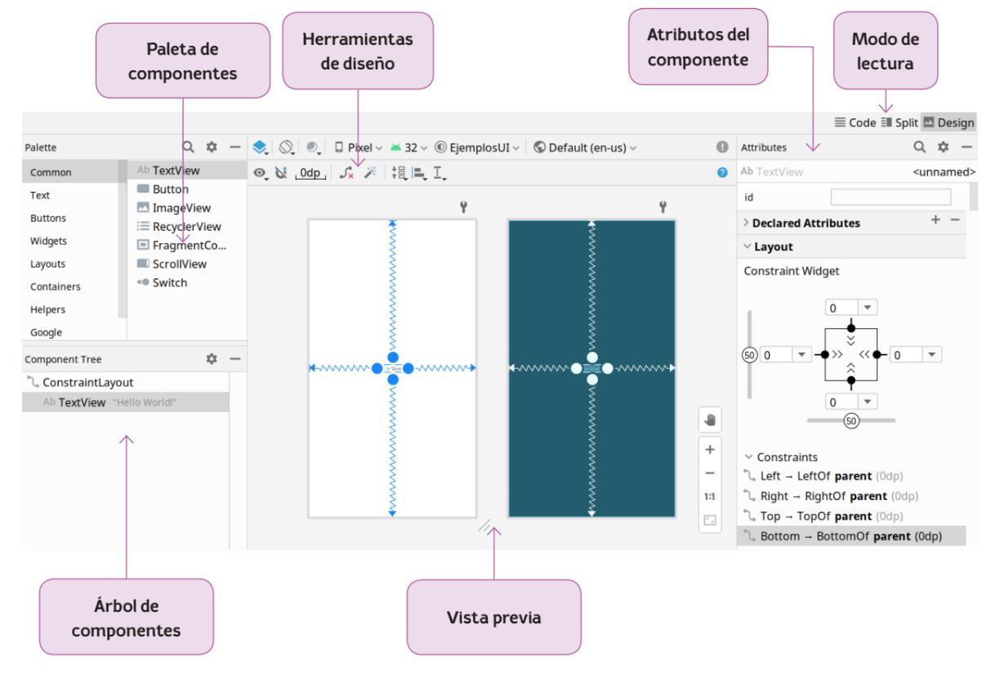

# 1.1 El editor de Layouts de Android Studio

> **Unidad 2 · Aplicaciones Android. Interfaz de usuario**
> Módulo: Programación multimedia y dispositivos móviles (2º DAM)

## Objetivos

Al terminar este apartado deberías ser capaz de:

- Identificar las zonas del editor de Layouts y para qué sirve cada una.
- Alternar entre los modos *Code*, *Split* y *Design*, y relacionar el diseño visual con su XML.
- Crear y modificar restricciones con el inspector de atributos: márgenes, sesgo y modo de tamaño.
- Distinguir los espacios de nombres `android:`, `app:` y `tools:`, y usar correctamente `dp` y `sp`.
- Aplicar buenas prácticas desde el primer layout: textos en `strings.xml`, ids significativos y panel de problemas sin avisos.

---

## 1. ¿Qué es un layout?

En Android, la interfaz de usuario de una pantalla se describe mediante un **layout**: un fichero XML que define **qué elementos** aparecen en pantalla (textos, botones, imágenes…) y **cómo se organizan** entre sí.

Separar la interfaz (XML) de la lógica (Kotlin) tiene varias ventajas:

- El diseño se puede modificar sin tocar el código de la aplicación.
- Permite definir **variantes** de una misma pantalla (orientación horizontal, tablets, idiomas…) sin duplicar lógica.
- El editor visual de Android Studio puede leer y escribir ese XML, de modo que podemos trabajar de forma gráfica o textual indistintamente.

> 💡 **Recuerda (UT01):** en el proyecto que creamos en la unidad anterior, la actividad `MainActivity` ya tenía asociado un layout: `activity_main.xml`.

---

## 2. Dónde se guardan los layouts y cómo se cargan

Los layouts son **recursos** de la aplicación y se guardan en la carpeta:

```
app/
└── src/main/res/layout/
    └── activity_main.xml
```

La actividad indica qué layout debe mostrar mediante `setContentView()`, usando la clase `R` que Android Studio genera automáticamente a partir de los recursos:

```kotlin
class MainActivity : AppCompatActivity() {
    override fun onCreate(savedInstanceState: Bundle?) {
        super.onCreate(savedInstanceState)
        enableEdgeToEdge()                       // Dibuja la app bajo las barras del sistema
        setContentView(R.layout.activity_main)  // Carga ("infla") el layout XML

        // Ajusta el relleno para que el contenido no quede tapado por las barras del sistema
        ViewCompat.setOnApplyWindowInsetsListener(findViewById(R.id.main)) { v, insets ->
            val systemBars = insets.getInsets(WindowInsetsCompat.Type.systemBars())
            v.setPadding(systemBars.left, systemBars.top, systemBars.right, systemBars.bottom)
            insets
        }
    }
}
```

> 📝 **Nota:** las plantillas actuales de Android Studio incluyen `enableEdgeToEdge()` y el bloque `setOnApplyWindowInsetsListener`. Por eso el layout raíz de la plantilla tiene `android:id="@+id/main"`. **No lo borres**: si lo eliminas, el código anterior fallará al no encontrar esa vista.

**Reglas de nombrado de los ficheros de layout:**

- Solo minúsculas, números y guiones bajos (`snake_case`): `activity_main.xml`, `activity_login.xml`.
- Prefijo según su uso: `activity_` para actividades, `fragment_` para fragmentos, `item_` para elementos de una lista (lo veremos con RecyclerView).

---

## 3. El editor de Layouts: visión general

Al abrir un fichero de layout, Android Studio muestra el **Layout Editor**. Sus zonas principales son:



| Zona | Función |
|------|---------|
| **Paleta de componentes** | Catálogo de vistas que podemos arrastrar al diseño. |
| **Árbol de componentes** | Jerarquía de las vistas del layout (quién contiene a quién). |
| **Herramientas de diseño** | Barras con opciones de previsualización y de ayuda a la maquetación. |
| **Vista previa** | Representación del layout en modo *Design* y *Blueprint*. |
| **Atributos del componente** | Propiedades de la vista seleccionada. |
| **Modo de lectura** | Alterna entre ver el XML (*Code*), el diseño (*Design*) o ambos (*Split*). |

Vamos a ver cada una en detalle.

---

## 4. Modos de lectura: Code, Split y Design

En la esquina superior derecha del editor encontramos tres botones:

| Modo | Qué muestra | Cuándo usarlo |
|------|-------------|---------------|
| **Code** | Solo el XML. | Ediciones rápidas, copiar/pegar atributos, revisar el código. |
| **Split** | XML y vista previa a la vez. | **El modo más recomendable para aprender**: ves cómo cada cambio en el XML se refleja en el diseño y viceversa. |
| **Design** | Solo el editor visual. | Arrastrar componentes y crear restricciones gráficamente. |

> ✅ **Recomendación:** trabaja en modo **Split**. El editor visual es muy útil, pero un desarrollador Android debe ser capaz de **leer y escribir el XML** con soltura.

---

## 5. Paleta de componentes

La **paleta** (*Palette*) contiene todas las vistas disponibles, organizadas por categorías:

| Categoría | Ejemplos |
|-----------|----------|
| **Common** | Los más usados: `TextView`, `Button`, `ImageView`, `RecyclerView`, `ScrollView`, `Switch`… |
| **Text** | `TextView`, campos `EditText` de distintos tipos (texto, contraseña, email, número…). |
| **Buttons** | `Button`, `ImageButton`, `CheckBox`, `RadioGroup`, `RadioButton`, `ToggleButton`, `Switch`, `FloatingActionButton`… |
| **Widgets** | `ImageView`, `ProgressBar`, `SeekBar`, `RatingBar`, `Spinner`, `WebView`… |
| **Layouts** | Contenedores: `ConstraintLayout`, `LinearLayout`, `FrameLayout`, `TableLayout`… |
| **Containers** | `ScrollView`, `CardView`, `RecyclerView`, `ViewPager2`, `Toolbar`… |
| **Helpers** | Elementos auxiliares de `ConstraintLayout`: `Guideline`, `Barrier`, `Group`, `Flow`… |
| **Google** | Componentes de servicios de Google (`AdView`, `MapView`). |

Para añadir un componente basta con **arrastrarlo** a la vista previa o al árbol de componentes. La lupa 🔍 de la paleta permite buscar un componente por nombre.

---

## 6. Árbol de componentes

El **árbol de componentes** (*Component Tree*) muestra la **jerarquía** del layout. En la imagen de ejemplo:

```
ConstraintLayout          ← contenedor raíz (ViewGroup)
 └── TextView "Hello World!"   ← vista hija
```

Es especialmente útil para:

- **Seleccionar** vistas pequeñas o superpuestas que cuesta pinchar en la vista previa.
- **Reordenar** o **mover** vistas de un contenedor a otro arrastrándolas.
- **Detectar avisos**: aparece un icono ⚠️ o ❗ junto a las vistas con problemas (texto sin traducir, falta de restricciones, etc.).
- Comprobar **cuánto anidamiento** tiene el diseño (cuanto menos, mejor; lo veremos en el punto 1.2).

---

## 7. Herramientas de diseño

Sobre la vista previa hay dos barras de herramientas.

### 7.1 Barra superior: configuración de la previsualización

Estas opciones **no modifican el layout**; solo cambian **cómo se previsualiza**:

| Icono / opción | Función |
|----------------|---------|
| **Design / Blueprint** (capas) | Muestra la vista de diseño, la de planos o ambas. |
| **Orientación** | Previsualiza en vertical (*portrait*) u horizontal (*landscape*). |
| **Modo noche** | Previsualiza el tema claro u oscuro. |
| **Dispositivo** (p. ej. *Pixel*) | Cambia el tamaño y densidad de pantalla. |
| **API** (p. ej. *32*) | Versión de Android con la que se renderiza la vista previa. |
| **Tema** (p. ej. *EjemplosUI*) | Tema visual aplicado. |
| **Idioma** (*Default (en-us)*) | Previsualiza los textos en otro idioma, si existen traducciones. |

### 7.2 Barra inferior: ayudas para ConstraintLayout

Cuando el contenedor raíz es un `ConstraintLayout`, aparece una segunda barra:

| Icono | Función |
|-------|---------|
| 👁 **View Options** | Muestra u oculta restricciones, márgenes, etc. |
| 🧲 **Autoconnect to Parent** | Crea restricciones automáticamente con el padre al soltar una vista. |
| **0dp** — *Default Margins* | Margen que se aplicará por defecto a las nuevas restricciones. |
| **Clear All Constraints** | Elimina **todas** las restricciones del layout (¡cuidado!). |
| 🪄 **Infer Constraints** | Android Studio intenta deducir las restricciones según la posición de las vistas. Útil como punto de partida, pero conviene revisar el resultado. |
| **Guidelines** | Añade líneas guía horizontales o verticales. |
| **Align** | Alinea varias vistas seleccionadas (izquierda, centro, base de texto…). |
| **Pack / Distribute** | Agrupa o reparte vistas uniformemente. |

### 7.3 Panel de problemas

El icono ❗ de la esquina superior derecha de la vista previa abre el **panel de problemas** (*Problems*), donde el editor muestra advertencias como:

- *Hardcoded string "Hello", should use @string resource* → texto escrito directamente en el XML.
- *This view is not constrained* → vista sin restricciones dentro de un `ConstraintLayout`.
- *Missing contentDescription attribute on image* → imagen sin descripción para accesibilidad.

> ✅ **Hábito profesional:** antes de dar por terminado un layout, abre el panel de problemas y resuelve todos los avisos que puedas.

---

## 8. Vista previa: Design y Blueprint

La zona central muestra el layout de dos formas (en la imagen aparecen ambas a la vez):

- **Design** (fondo blanco): aproximación realista de cómo se verá en el dispositivo, con colores, textos e imágenes.
- **Blueprint** (fondo azul oscuro): vista de "planos" que muestra solo los **contornos** de las vistas y sus **restricciones**. Es muy útil para ver vistas invisibles o superpuestas.

En la vista previa de un `ConstraintLayout`, al seleccionar una vista se observan:

- **Círculos en los bordes** (*handles* de anclaje): se arrastran hasta otra vista o hasta el borde del padre para crear una **restricción**.
- **Líneas en zigzag** (muelles): indican una restricción que "tira" de la vista. En la imagen, el `TextView` está restringido a los cuatro bordes del padre, por lo que queda **centrado**.
- **Cuadrados en las esquinas**: permiten redimensionar la vista.

En el lateral derecho hay controles de **zoom** (+, −, 1:1, ajustar a pantalla) y la herramienta **mano** ✋ para desplazarse.

---

## 9. Atributos del componente

El panel **Attributes** muestra las propiedades de la vista seleccionada. Se organiza en secciones:

### 9.1 `id`

Identificador único de la vista. Es imprescindible para:

- Referenciarla desde el código Kotlin.
- Usarla como referencia en las restricciones de otras vistas.

En XML se escribe `android:id="@+id/tvSaludo"` (el `+` indica que se **crea** el identificador).

> 📝 **Convención de nombres de id:** usaremos *camelCase* con un prefijo que indique el tipo de vista: `tvTitulo` (TextView), `btnAceptar` (Button), `etNombre` (EditText), `ivLogo` (ImageView)… Así el código resulta más legible. Esta convención será especialmente útil cuando veamos **View Binding** en el punto 2.

### 9.2 Declared Attributes

Lista **solo los atributos que ya están escritos** en el XML para esa vista. Con **+** se añade uno nuevo y con **−** se elimina.

### 9.3 Layout — Constraint Widget

Si la vista está dentro de un `ConstraintLayout`, aparece el **inspector de restricciones** (el cuadrado central de la imagen):

```
            [ 0 ▾ ]              ← margen superior
               │
  [50] [0 ▾]──┤ >>  << ├──[0 ▾]  ← márgenes izquierdo y derecho
               │
            [ 0 ▾ ]              ← margen inferior
              (50)               ← sesgo horizontal
```

- **Puntos negros** en cada lado: indican que existe una restricción en esa dirección. Haciendo clic se elimina; en el círculo vacío, se crea.
- **Desplegables numéricos**: valor del **margen** de cada restricción.
- **Deslizadores con el valor 50** (*bias* o sesgo): cuando una vista está restringida por dos lados opuestos, el sesgo indica hacia dónde se desplaza. `50` = centrada; `0` = pegada a la izquierda/arriba; `100` = pegada a la derecha/abajo.
- **Símbolos del interior del cuadrado**: controlan el **tamaño** de la vista en cada eje. Pinchando sobre ellos se alterna entre:

| Símbolo | Modo | XML |
|---------|------|-----|
| `>> <<` | Ajustar al contenido | `wrap_content` |
| `├─┤` | Tamaño fijo | p. ej. `120dp` |
| `\/\/\/` (muelle) | Ocupar el espacio que permitan las restricciones (*match constraints*) | `0dp` |

Debajo aparece la lista **Constraints**, con cada restricción en forma textual. En la imagen:

```
Left   → LeftOf   parent (0dp)
Right  → RightOf  parent (0dp)
Top    → TopOf    parent (0dp)
Bottom → BottomOf parent (0dp)
```

### 9.4 Common Attributes y All Attributes

- **Common Attributes**: los atributos más habituales del tipo de vista seleccionada (texto, tamaño de letra, color, imagen…).
- **All Attributes**: listado completo y alfabético de **todos** los atributos posibles.

La lupa 🔍 del panel permite buscar un atributo por nombre, lo que suele ser más rápido que recorrer las secciones.

---

## 10. Del editor visual al XML

Todo lo que hacemos en el editor visual se traduce a XML. El diseño de la imagen corresponde a este código:

```xml
<?xml version="1.0" encoding="utf-8"?>
<androidx.constraintlayout.widget.ConstraintLayout
    xmlns:android="http://schemas.android.com/apk/res/android"
    xmlns:app="http://schemas.android.com/apk/res-auto"
    xmlns:tools="http://schemas.android.com/tools"
    android:id="@+id/main"
    android:layout_width="match_parent"
    android:layout_height="match_parent"
    tools:context=".MainActivity">

    <TextView
        android:id="@+id/tvSaludo"
        android:layout_width="wrap_content"
        android:layout_height="wrap_content"
        android:text="Hello World!"
        app:layout_constraintBottom_toBottomOf="parent"
        app:layout_constraintEnd_toEndOf="parent"
        app:layout_constraintStart_toStartOf="parent"
        app:layout_constraintTop_toTopOf="parent" />

</androidx.constraintlayout.widget.ConstraintLayout>
```

### Los tres espacios de nombres (*namespaces*)

| Prefijo | Para qué sirve | Ejemplo |
|---------|----------------|---------|
| `android:` | Atributos estándar del framework de Android. | `android:text`, `android:layout_width` |
| `app:` | Atributos definidos por librerías (AndroidX, Material, ConstraintLayout). | `app:layout_constraintTop_toTopOf` |
| `tools:` | Atributos **solo para el editor**. **No llegan a la aplicación** que se ejecuta. | `tools:context`, `tools:text` |

El espacio `tools:` es muy útil para previsualizar datos de ejemplo sin que aparezcan en la app real:

```xml
<TextView
    android:id="@+id/tvNombreUsuario"
    android:layout_width="wrap_content"
    android:layout_height="wrap_content"
    tools:text="Ana García" />  <!-- Solo se ve en el editor; en la app se rellenará desde Kotlin -->
```

> ⚠️ **Left/Right frente a Start/End:** el inspector de la imagen muestra las restricciones como *Left/Right*, pero en el XML las plantillas actuales usan **Start/End**. Se recomienda **Start/End** porque se adaptan automáticamente a idiomas que se escriben de derecha a izquierda (árabe, hebreo): *Start* es la izquierda en español y la derecha en árabe.

---

## 11. Unidades de medida: dp y sp

Los dispositivos Android tienen pantallas de tamaños y **densidades** (píxeles por pulgada) muy distintos. Si usáramos píxeles (`px`), un botón de 100 px se vería grande en un móvil antiguo y diminuto en uno moderno. Por eso Android usa unidades independientes de la densidad:

| Unidad | Nombre | Uso |
|--------|--------|-----|
| **dp** (o `dip`) | *Density-independent pixel* | **Tamaños, márgenes y rellenos** de las vistas. 1 dp ≈ 1 px en una pantalla de 160 dpi. |
| **sp** | *Scale-independent pixel* | **Tamaño de texto**. Como el dp, pero además respeta el tamaño de fuente que el usuario haya elegido en los ajustes de accesibilidad. |
| px | Píxel real | Prácticamente nunca se usa en layouts. |

```xml
<TextView
    android:layout_width="wrap_content"
    android:layout_height="wrap_content"
    android:layout_margin="16dp"   
    android:textSize="18sp"        
    android:text="@string/bienvenida" />
```

> ✅ **Regla de oro:** `dp` para todo **excepto** para el tamaño del texto, que va en `sp`.

---

## 12. Buenas prácticas desde el primer layout

1. **No escribas textos directamente en el layout.** Defínelos en `res/values/strings.xml` y referéncialos con `@string/...`. Facilita la traducción y el mantenimiento.

   ```xml
   <!-- res/values/strings.xml -->
   <resources>
       <string name="app_name">EjemplosUI</string>
       <string name="bienvenida">¡Hola, mundo!</string>
   </resources>
   ```

   ```xml
   android:text="@string/bienvenida"
   ```

   > 💡 **Atajo:** sitúa el cursor sobre un texto escrito a mano y pulsa `Alt + Enter` → *Extract string resource*. Android Studio crea el recurso y sustituye el texto automáticamente.

2. **Asigna un `id` significativo** a toda vista que vayas a usar desde Kotlin o como referencia de otras restricciones.
3. **Restringe todas las vistas** dentro de un `ConstraintLayout`. Una vista sin restricciones se ve bien en el editor, pero en ejecución aparece en la esquina superior izquierda (posición 0,0).
4. **Comprueba el diseño en varios dispositivos y orientaciones** con la barra superior. También puedes usar **Layout Validation** (pestaña lateral derecha en algunas versiones o menú *View → Tool Windows → Layout Validation*) para verlo en varios tamaños a la vez.
5. **Revisa el panel de problemas** ❗ antes de dar el layout por terminado.

---

## 13. Practica

1. Crea un proyecto **Empty Views Activity** llamado `EjemplosUI` (Kotlin, API mínima 24). Abre `activity_main.xml` en modo **Split** y localiza las seis zonas del editor (apartado 3).
2. Selecciona el `TextView` "Hello World!": asígnale el id `tvSaludo`, cambia su tamaño a `24sp` y extrae el texto a `strings.xml` con el nombre `saludo` y el valor "¡Hola, DAM!" (`Alt + Enter` → *Extract string resource*).
3. En el inspector de restricciones, mueve el **sesgo vertical** a `20`. ¿Qué atributo nuevo aparece en el XML?
4. Arrastra un `Button` y crea sus restricciones **gráficamente**: parte superior → parte inferior de `tvSaludo` con `32dp` de margen; inicio y fin → inicio y fin del padre.
5. Cambia la previsualización a **horizontal**, a **modo oscuro** y a un **dispositivo tablet**. ¿Se mantiene la disposición?
6. Pulsa **Clear All Constraints** y ejecuta la app. ¿Dónde aparecen las vistas? ¿Por qué? Deshaz con `Ctrl + Z` y vuelve a ejecutar.
7. Añade a `tvSaludo` un atributo `tools:text` con otro texto. ¿Qué ves en el editor? ¿Y al ejecutar la app?
8. **Reto:** abre el panel de problemas ❗ y deja el layout **sin ningún aviso**.

---

## 14. Autoevaluación

1. ¿En qué carpeta se guardan los layouts? ¿Cómo indica la actividad cuál debe mostrar?
2. ¿Qué diferencia hay entre los modos *Code*, *Split* y *Design*? ¿Cuál se recomienda para aprender y por qué?
3. ¿Para qué sirve el árbol de componentes? Indica al menos dos usos.
4. ¿Qué diferencia hay entre la vista *Design* y la vista *Blueprint*?
5. En el inspector de restricciones, ¿qué significa un sesgo de `50`? ¿Y uno de `0`?
6. ¿Qué tres modos de tamaño ofrece el inspector y a qué valor del XML corresponde cada uno?
7. ¿Qué ocurre en ejecución con una vista que no tiene restricciones dentro de un `ConstraintLayout`?
8. ¿Qué diferencia hay entre `android:text` y `tools:text`?
9. ¿Por qué se recomienda usar *Start/End* en lugar de *Left/Right* en las restricciones?
10. ¿Cuándo se usa `dp` y cuándo `sp`? ¿Por qué no se usan píxeles?

---

## 📚 Para saber más (documentación oficial)

- [Cómo desarrollar una UI con views (editor de diseño)](https://developer.android.com/studio/views/layout-editor?hl=es-419) · Guía completa del editor: paleta, atributos, restricciones y vista previa.
- [Cómo compilar una IU responsiva con ConstraintLayout](https://developer.android.com/training/constraint-layout?hl=es-419) · Cómo crear y ajustar restricciones desde el editor visual.
- [Diseños en Views](https://developer.android.com/guide/topics/ui/declaring-layout?hl=es-419) · Qué es un layout, cómo se escribe en XML y cómo se carga desde el código.
- [Cómo hacer que las apps sean más accesibles](https://developer.android.com/guide/topics/ui/accessibility/apps?hl=es-419) · Base de los avisos de accesibilidad que muestra el panel de problemas.

---

⬅️ [Volver al índice](../README.md) · ➡️ [1.2 Diseño de Layouts](01-2-diseno-de-layouts.md)
