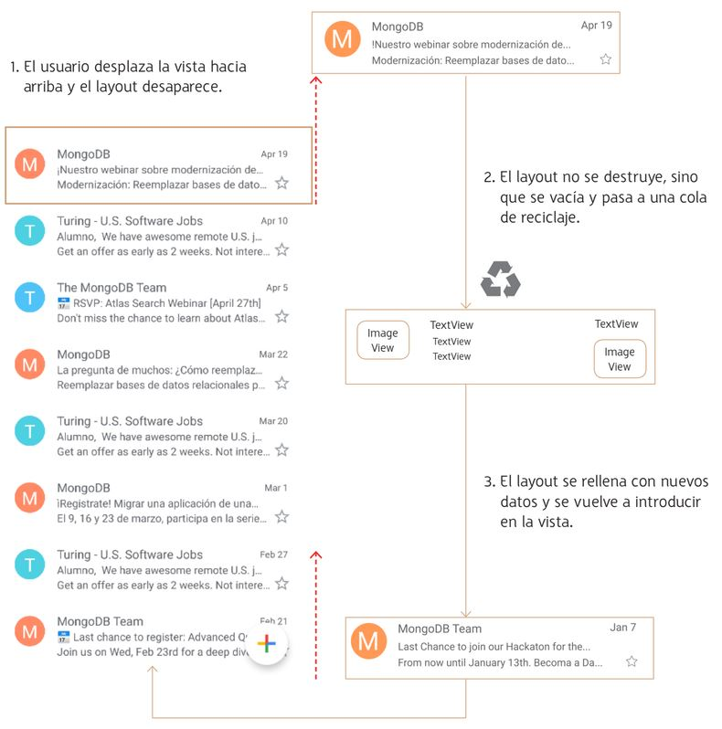

# 5.1 Listas con RecyclerView

> **Unidad 2 · Aplicaciones Android. Interfaz de usuario**
> Módulo: Programación multimedia y dispositivos móviles (2º DAM)

## Objetivos

Al terminar este apartado deberías ser capaz de:

- Reconocer cuándo una interfaz necesita una lista dinámica.
- Explicar por qué no se construye una lista larga con un `LinearLayout` dentro de un `ScrollView`.
- Describir el mecanismo de reciclado de vistas en el que se basa `RecyclerView`.
- Comparar `RecyclerView` con el antiguo `ListView`.

---

## 1. Las listas, en todas partes

Casi cualquier conjunto de datos se presenta al usuario como una **lista de elementos**: contactos, conversaciones de una app de mensajería, correos, productos de una tienda, canciones, tareas… Todas tienen algo en común:

- Cada elemento se muestra con el **mismo diseño** (por ejemplo, un correo: remitente, asunto, fecha e icono).
- El **número de elementos varía**: puede haber 3 o 3000, y cambia mientras se usa la app.
- Los datos pueden venir de **muchas fuentes**: una lista en memoria, un fichero, una base de datos local o Internet.

Por eso, una lista no se diseña elemento a elemento en el XML, sino que se **genera desde el código** a partir de los datos.

---

## 2. La solución ingenua: un layout por elemento

Con lo visto en los puntos anteriores, podríamos pensar en algo así:

```kotlin
// ❌ NO hagas esto con listas largas
for (correo in correos) {                                   // 3000 correos
    val fila = ItemCorreoBinding.inflate(layoutInflater)    // se crea una fila…
    fila.tvAsunto.text = correo.asunto
    binding.contenedor.addView(fila.root)                   // …y se añade a un LinearLayout
}                                                           // dentro de un ScrollView
```

Funciona con pocos elementos, pero con miles es un desastre:

| Problema | Por qué |
|---|---|
| **Memoria** | Se crean **3000 filas** con todas sus vistas, aunque en pantalla solo quepan 8. |
| **Tiempo de arranque** | Inflar 3000 layouts tarda: la pantalla se queda en blanco o la app se bloquea. |
| **Desplazamiento lento** | El sistema tiene que medir y dibujar un árbol de vistas enorme (punto 1.2). |
| **Actualizar es costoso** | Para añadir o borrar un elemento hay que reconstruir buena parte de la lista. |

> 📌 **Relación con el punto 1.2:** allí vimos que **nunca** se debe meter una lista de datos de longitud variable en un `ScrollView` ni construirla con `LinearLayout`, sino usar `RecyclerView`. Ahora vamos a ver por qué.

---

## 3. La idea clave: reciclar las vistas

La observación de partida es sencilla: **en pantalla solo se ven unos pocos elementos a la vez**. Si caben 8 correos, no hace falta crear 3000 filas: basta con crear **unas pocas más** de las visibles y **reutilizarlas** a medida que el usuario se desplaza.

Eso es exactamente lo que hace `RecyclerView`, y de ahí su nombre: **recicla** las vistas.



El proceso, siguiendo la imagen:

1. **El usuario desplaza la lista hacia arriba** y el primer elemento sale de la pantalla.
2. **El layout de esa fila no se destruye**: se vacía y pasa a una **cola de reciclaje** (en la imagen, una fila "en blanco" con sus `ImageView` y `TextView`).
3. **El layout se rellena con los datos de un nuevo elemento** (el que va a aparecer por abajo) y se vuelve a introducir en la lista.

Así, aunque la lista tenga 3000 elementos, **solo existen unas 10 o 12 filas en memoria**, que se van rellenando una y otra vez con datos distintos.

| | Un layout por elemento | `RecyclerView` |
|---|---|---|
| Filas creadas para 3000 elementos | 3000 | ~10–12 (las visibles y alguna más) |
| Memoria | Crece con los datos | Casi constante |
| Desplazamiento | Lento con muchos datos | Fluido |
| Inflar layouts | Al principio, todos | Solo al empezar; después, se reciclan |

> ⚠️ **Consecuencia importante del reciclado:** una fila reutilizada **conserva lo que tenía** del elemento anterior. Si en un elemento cambias el color de un texto y en otro no, al reciclar la fila el color "se arrastra". Por eso, al rellenar una fila hay que **asignar siempre todos sus valores**, también los que vuelven al estado normal. Lo veremos en el punto 5.3.

---

## 4. De `ListView` a `RecyclerView`

Durante años, Android ofreció `ListView` para mostrar listas. Hoy aparece en la paleta en la categoría **Legacy** (heredado), y la recomendación es usar `RecyclerView`.

| | `ListView` | `RecyclerView` |
|---|---|---|
| Situación | **Legacy**: solo para mantener código antiguo | **Recomendado** |
| Reciclado de vistas | Opcional: el programador debía reutilizar `convertView` | **Obligatorio** e integrado: siempre se recicla |
| Patrón *ViewHolder* | Opcional | **Obligatorio** |
| Disposición | Solo lista vertical | Lista vertical u horizontal, cuadrícula, cuadrícula escalonada… |
| Animaciones al añadir o borrar | No | Sí, incluidas |
| Separadores, decoraciones | Fijos | Personalizables con `ItemDecoration` |
| Clic en un elemento | `setOnItemClickListener` ya incluido | Lo programamos nosotros (punto 5.4) |

> 📝 **Relación con la presentación de clase:** los ejemplos de `ListView` y `Spinner` con `ArrayAdapter` usan la misma idea de **adaptador** que vamos a ver. Lo que aprendiste allí te servirá para entender `RecyclerView`.

`RecyclerView` es algo más laborioso de montar, porque reparte el trabajo entre varias piezas. A cambio, es mucho más eficiente y flexible. Esas piezas son el contenido del punto 5.2.

---

## 5. Practica

1. Abre en tu móvil tres apps que usen listas (correo, mensajería, una tienda…). Para cada una, anota qué datos muestra cada elemento y si la lista es vertical, horizontal o una cuadrícula.
2. Crea un proyecto `ListaIngenua` con View Binding, un `ScrollView` y dentro un `LinearLayout` vertical con id `contenedor`.
3. Crea un layout `item_numero.xml` con un `TextView` y añade 50 filas con el bucle de la sección 2, cada una con su número.
4. Cambia el bucle a 20 000 elementos. Mide cuánto tarda la pantalla en aparecer y comprueba si el desplazamiento es fluido. Observa el uso de memoria en *View → Tool Windows → Profiler*.
5. Abre la paleta del editor de layouts y localiza `ListView` y `RecyclerView`. ¿En qué categoría está cada uno?
6. **Reto:** con un lápiz, dibuja una pantalla en la que caben 6 elementos. Si la lista tiene 100, ¿cuántas filas crees que necesita `RecyclerView`? ¿Qué ocurre con la fila del elemento 1 cuando aparece en pantalla el elemento 8?

---

## 6. Autoevaluación

1. ¿Qué tienen en común todas las listas de datos de una app?
2. ¿Por qué una lista no se diseña elemento a elemento en el XML?
3. ¿Qué problemas tiene construir una lista larga con un `LinearLayout` dentro de un `ScrollView`?
4. ¿En qué observación se basa el reciclado de vistas?
5. Describe los tres pasos del reciclado de una fila.
6. Para una lista de 3000 elementos, ¿cuántas filas existen aproximadamente en memoria con `RecyclerView`?
7. ¿Por qué hay que asignar **todos** los valores de una fila cada vez que se rellena?
8. ¿En qué categoría de la paleta aparece hoy `ListView`? ¿Qué significa?
9. Indica tres ventajas de `RecyclerView` frente a `ListView`.
10. ¿Qué tienen en común `RecyclerView` y los `Spinner` o `ListView` de la presentación de clase?

---

## 📚 Para saber más (documentación oficial)

- [Cómo crear listas dinámicas con RecyclerView](https://developer.android.com/develop/ui/views/layout/recyclerview?hl=es-419) · Guía oficial: conceptos e implementación.
- [Referencia de RecyclerView](https://developer.android.com/reference/androidx/recyclerview/widget/RecyclerView) (en inglés) · Todas las clases y métodos.

---

⬅️ [4.4 Mejorando el comportamiento de las Intents](04-4-intents-y-menus-contextuales.md) · 🏠 [Índice](../README.md) · ➡️ [5.2 Elementos para crear un RecyclerView](05-2-elementos-recyclerview.md)
