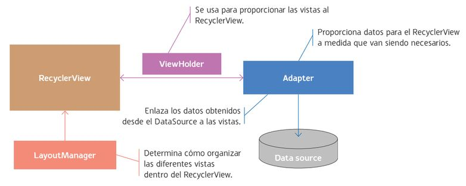

# 5.2 Elementos para crear un RecyclerView

> **Unidad 2 · Aplicaciones Android. Interfaz de usuario**
> Módulo: Programación multimedia y dispositivos móviles (2º DAM)

## Objetivos

Al terminar este apartado deberías ser capaz de:

- Identificar las piezas que forman un `RecyclerView` y la responsabilidad de cada una.
- Elegir el `LayoutManager` adecuado: lista, cuadrícula o cuadrícula escalonada.
- Diseñar el modelo de datos con una `data class`.
- Diseñar el layout de un elemento de la lista.
- Añadir el `RecyclerView` al layout de la actividad.

---

## 1. Un trabajo en equipo

A diferencia de un `TextView` o un `Button`, un `RecyclerView` **no funciona solo**. Reparte el trabajo entre varias piezas, cada una con una responsabilidad:



| Pieza | Responsabilidad | ¿Quién la crea? |
|---|---|---|
| **RecyclerView** | El **contenedor** que se pone en el layout. Muestra los elementos, gestiona el desplazamiento y el reciclado. | Android (va en el XML). |
| **LayoutManager** | Decide **cómo se organizan** las vistas: en lista vertical, horizontal, cuadrícula… | Se elige una de Android. |
| **Adapter** | El **intermediario** entre los datos y la lista: cuántos elementos hay, crea las filas y las rellena. | **Nosotros**. |
| **ViewHolder** | **Guarda las vistas** de una fila para no tener que buscarlas cada vez que se recicla. | **Nosotros**. |
| **Data source** | Los **datos**: una lista en memoria, una base de datos, Internet… | Nosotros. |

Además, cada fila necesita su **layout XML**, igual que cualquier pantalla.

> 📌 **Relación con POO:** es una aplicación clara del principio de **responsabilidad única**: cada clase hace una sola cosa. Y el *Adapter* sigue el patrón **Adapter**, que ya vimos con el `Spinner` (punto 1.3): adapta los datos al formato que necesita la vista.

### 1.1 Cómo se relacionan

```
  Datos (List<Pizza>)
        │
        ▼
  ┌───────────┐  crea y rellena   ┌────────────┐  contiene   ┌──────────────┐
  │  Adapter  │ ────────────────► │ ViewHolder │ ──────────► │ item_pizza   │
  └───────────┘                   └────────────┘             │   (.xml)     │
        ▲                                                    └──────────────┘
        │ adapter = …
  ┌──────────────┐  layoutManager = …  ┌───────────────┐
  │ RecyclerView │ ◄────────────────── │ LayoutManager │
  └──────────────┘                     └───────────────┘
```

Para montar un `RecyclerView` daremos estos pasos, que se reparten entre este apartado y el siguiente:

| Paso | Qué | Apartado |
|---|---|---|
| 1 | Comprobar la dependencia | 5.2 |
| 2 | Crear el **modelo de datos** | 5.2 |
| 3 | Diseñar el **layout de un elemento** | 5.2 |
| 4 | Añadir el `RecyclerView` al **layout de la actividad** | 5.2 |
| 5 | Crear el **ViewHolder** | 5.3 |
| 6 | Crear el **Adapter** | 5.3 |
| 7 | **Conectar** todo en la actividad: `LayoutManager` y `Adapter` | 5.3 |

---

## 2. La dependencia

`RecyclerView` no forma parte del sistema Android, sino de la librería **AndroidX**. En los proyectos actuales ya está disponible, porque la incluye la librería Material (`com.google.android.material`), que añade la plantilla.

Si no lo estuviera (Android Studio marcaría `RecyclerView` en rojo), se añade en `app/build.gradle.kts`:

```kotlin
dependencies {
    implementation("androidx.recyclerview:recyclerview:1.4.0")
    // ...
}
```

> 💡 Usa la versión que te proponga Android Studio. Si escribes una antigua, la subrayará y ofrecerá actualizarla con `Alt + Enter`.

---

## 3. El modelo de datos

Lo primero es decidir **qué datos** muestra cada elemento. Para la carta de la *Pizzería DAM*, cada pizza tiene un nombre, sus ingredientes, un precio y una imagen. Se representa con una **`data class`**:

```kotlin
// Pizza.kt
package com.dam.pizzeria

import androidx.annotation.DrawableRes

data class Pizza(
    val nombre: String,
    val ingredientes: String,
    val precio: Double,
    @DrawableRes val imagen: Int,       // id de un recurso drawable: R.drawable.margarita
    val vegetariana: Boolean = false
)
```

> 📌 **Relación con Kotlin (UT01):** una `data class` genera automáticamente `toString()`, `equals()`, `hashCode()` y `copy()`. `@DrawableRes` es una anotación que avisa si por error se pasa un número que no es un recurso de imagen.

Y una fuente de datos. Para empezar, una lista en memoria:

```kotlin
// FuenteDatos.kt
object FuenteDatos {
    val pizzas = listOf(
        Pizza("Margarita", "Tomate, mozzarella, albahaca", 8.50, R.drawable.margarita, vegetariana = true),
        Pizza("Barbacoa", "Salsa barbacoa, carne picada, bacon, cebolla", 10.95, R.drawable.barbacoa),
        Pizza("Cuatro quesos", "Mozzarella, gorgonzola, parmesano, emmental", 10.50, R.drawable.cuatro_quesos, vegetariana = true),
        Pizza("Carbonara", "Nata, bacon, champiñones, cebolla", 10.50, R.drawable.carbonara),
        Pizza("Hawaiana", "Tomate, mozzarella, jamón york, piña", 9.95, R.drawable.hawaiana),
        // ... añade al menos 15 para notar el desplazamiento
    )
}
```

> 📝 Un `object` en Kotlin es un **Singleton**: existe una sola instancia, accesible como `FuenteDatos.pizzas`. Más adelante, los datos vendrán de una base de datos o de Internet, y **solo cambiará esta parte**.

---

## 4. El layout de un elemento

Cada elemento de la lista tiene su propio layout. Por convenio, su nombre empieza por **`item_`** (punto 1.1):

```
┌──────────────────────────────────────────────┐
│ ┌──────┐  Margarita                  8,50 €  │
│ │ foto │  Tomate, mozzarella, albahaca        │
│ └──────┘  Vegetariana                         │
└──────────────────────────────────────────────┘
```

**`res/layout/item_pizza.xml`**:

```xml
<?xml version="1.0" encoding="utf-8"?>
<com.google.android.material.card.MaterialCardView
    xmlns:android="http://schemas.android.com/apk/res/android"
    xmlns:app="http://schemas.android.com/apk/res-auto"
    xmlns:tools="http://schemas.android.com/tools"
    android:layout_width="match_parent"
    android:layout_height="wrap_content"
    android:layout_marginHorizontal="12dp"
    android:layout_marginVertical="6dp"
    app:cardCornerRadius="12dp">

    <androidx.constraintlayout.widget.ConstraintLayout
        android:layout_width="match_parent"
        android:layout_height="wrap_content"
        android:padding="12dp">

        <ImageView
            android:id="@+id/ivPizza"
            android:layout_width="72dp"
            android:layout_height="72dp"
            android:scaleType="centerCrop"
            android:importantForAccessibility="no"
            app:layout_constraintStart_toStartOf="parent"
            app:layout_constraintTop_toTopOf="parent"
            tools:src="@drawable/margarita" />

        <TextView
            android:id="@+id/tvNombre"
            android:layout_width="0dp"
            android:layout_height="wrap_content"
            android:layout_marginStart="12dp"
            android:textAppearance="?attr/textAppearanceTitleMedium"
            app:layout_constraintStart_toEndOf="@id/ivPizza"
            app:layout_constraintEnd_toStartOf="@id/tvPrecio"
            app:layout_constraintTop_toTopOf="parent"
            tools:text="Margarita" />

        <TextView
            android:id="@+id/tvPrecio"
            android:layout_width="wrap_content"
            android:layout_height="wrap_content"
            android:textAppearance="?attr/textAppearanceTitleMedium"
            app:layout_constraintEnd_toEndOf="parent"
            app:layout_constraintBaseline_toBaselineOf="@id/tvNombre"
            tools:text="8,50 €" />

        <TextView
            android:id="@+id/tvIngredientes"
            android:layout_width="0dp"
            android:layout_height="wrap_content"
            android:layout_marginTop="4dp"
            android:maxLines="2"
            android:ellipsize="end"
            app:layout_constraintStart_toStartOf="@id/tvNombre"
            app:layout_constraintEnd_toEndOf="parent"
            app:layout_constraintTop_toBottomOf="@id/tvNombre"
            tools:text="Tomate, mozzarella, albahaca" />

        <TextView
            android:id="@+id/tvVegetariana"
            android:layout_width="wrap_content"
            android:layout_height="wrap_content"
            android:layout_marginTop="4dp"
            android:text="@string/vegetariana"
            android:textColor="?attr/colorPrimary"
            app:layout_constraintStart_toStartOf="@id/tvNombre"
            app:layout_constraintTop_toBottomOf="@id/tvIngredientes" />

    </androidx.constraintlayout.widget.ConstraintLayout>
</com.google.android.material.card.MaterialCardView>
```

Aspectos importantes:

- **`layout_height="wrap_content"` en la raíz.** Si pones `match_parent`, **cada fila ocupará toda la pantalla**. Es un error muy frecuente.
- **`tools:text` y `tools:src`** (punto 1.1): permiten ver un ejemplo en el editor, pero no aparecen en la app. Los valores reales los pondrá el adaptador.
- **`MaterialCardView`** da a cada elemento aspecto de tarjeta, con esquinas redondeadas y sombra. También podría ser un `ConstraintLayout` directamente.
- La raíz **no necesita id**: la clase de vinculación `ItemPizzaBinding` (punto 2) da acceso a ella con `root`.

---

## 5. El `RecyclerView` en el layout de la actividad

**`res/layout/activity_carta.xml`**:

```xml
<androidx.constraintlayout.widget.ConstraintLayout
    xmlns:android="http://schemas.android.com/apk/res/android"
    xmlns:app="http://schemas.android.com/apk/res-auto"
    xmlns:tools="http://schemas.android.com/tools"
    android:id="@+id/main"
    android:layout_width="match_parent"
    android:layout_height="match_parent">

    <include
        android:id="@+id/toolbar"
        layout="@layout/toolbar" />

    <androidx.recyclerview.widget.RecyclerView
        android:id="@+id/rvPizzas"
        android:layout_width="0dp"
        android:layout_height="0dp"
        android:clipToPadding="false"
        android:paddingVertical="6dp"
        app:layout_constraintTop_toBottomOf="@id/toolbar"
        app:layout_constraintBottom_toBottomOf="parent"
        app:layout_constraintStart_toStartOf="parent"
        app:layout_constraintEnd_toEndOf="parent"
        tools:listitem="@layout/item_pizza"
        tools:itemCount="5" />

</androidx.constraintlayout.widget.ConstraintLayout>
```

| Atributo | Para qué |
|---|---|
| `0dp` en ancho y alto | El `RecyclerView` ocupa todo el espacio entre la toolbar y el borde inferior (punto 1.2). |
| `clipToPadding="false"` | El relleno superior e inferior no recorta los elementos al desplazarse. |
| `tools:listitem` | Muestra en el **editor** cómo quedará la lista con ese layout de elemento. |
| `tools:itemCount` | Cuántos elementos de ejemplo se muestran en el editor. |

> ⚠️ **Nunca** metas un `RecyclerView` dentro de un `ScrollView` (punto 1.2): ambos intentan gestionar el desplazamiento y se pierde el reciclado.

---

## 6. El `LayoutManager`: cómo se colocan los elementos

El `LayoutManager` decide la disposición de las filas. Android incluye tres:

| `LayoutManager` | Disposición | Ejemplo |
|---|---|---|
| `LinearLayoutManager` | Lista **vertical** (por defecto) u **horizontal**. | Correos, contactos; un carrusel horizontal. |
| `GridLayoutManager` | **Cuadrícula** con un número fijo de columnas. | Galería de fotos, catálogo de productos. |
| `StaggeredGridLayoutManager` | Cuadrícula **escalonada**: elementos de distinta altura. | Tablero de notas o de imágenes de distintos tamaños. |

```kotlin
// Lista vertical
binding.rvPizzas.layoutManager = LinearLayoutManager(this)

// Lista horizontal (carrusel)
binding.rvPizzas.layoutManager = LinearLayoutManager(this, LinearLayoutManager.HORIZONTAL, false)

// Cuadrícula de 2 columnas
binding.rvPizzas.layoutManager = GridLayoutManager(this, 2)

// Cuadrícula escalonada de 2 columnas
binding.rvPizzas.layoutManager = StaggeredGridLayoutManager(2, StaggeredGridLayoutManager.VERTICAL)
```

> ✅ Cambiar la disposición es **una sola línea**: el adaptador, el ViewHolder y los datos no cambian. Es la ventaja de separar responsabilidades.

> 💡 También se puede indicar en el XML, con `app:layoutManager="androidx.recyclerview.widget.LinearLayoutManager"`. En este curso lo haremos desde el código, para verlo junto al adaptador.

> ⚠️ Sin `LayoutManager`, el `RecyclerView` **no muestra nada**. En el Logcat aparece el aviso *"No layout manager attached; skipping layout"*.

---

## 7. Practica

1. Crea un proyecto `CartaPizzeria` con View Binding (o continúa en `PizzeriaMenus`, en `CartaActivity`).
2. Comprueba que `RecyclerView` está disponible: escribe `RecyclerView` en una actividad y mira si Android Studio lo reconoce.
3. Crea la `data class Pizza` y el `object FuenteDatos` con al menos **15 pizzas**. Para las imágenes, puedes usar iconos de *Vector Asset* o fotos libres en `res/drawable`.
4. Diseña `item_pizza.xml` y comprueba en el editor el aspecto con `tools:text` y `tools:src`.
5. Añade el `RecyclerView` al layout de la actividad con `tools:listitem` y `tools:itemCount`. ¿Cómo se ve en el editor?
6. Cambia la raíz de `item_pizza.xml` a `layout_height="match_parent"` y observa la vista previa del `RecyclerView`. Después, déjalo como estaba.
7. **Reto:** dibuja en papel cómo quedaría la carta con cada uno de los tres `LayoutManager`. ¿Cuál elegirías para una carta con fotos grandes? ¿Y para un carrusel de ofertas?

---

## 8. Autoevaluación

1. ¿Qué piezas intervienen en un `RecyclerView`? Indica la responsabilidad de cada una.
2. ¿Cuáles de esas piezas programamos nosotros y cuáles proporciona Android?
3. ¿Qué patrón de diseño sigue el *Adapter*? ¿Dónde lo habías visto antes?
4. ¿Por qué se usa una `data class` para el modelo de datos?
5. ¿Qué pasa si la raíz del layout de un elemento tiene `layout_height="match_parent"`?
6. ¿Para qué sirven `tools:listitem` y `tools:itemCount`?
7. ¿Qué tres `LayoutManager` incluye Android? Pon un ejemplo de uso de cada uno.
8. ¿Qué hay que cambiar para pasar de una lista vertical a una cuadrícula de 3 columnas?
9. ¿Qué ocurre si no se asigna ningún `LayoutManager`?
10. ¿Por qué no se debe poner un `RecyclerView` dentro de un `ScrollView`?

---

## 📚 Para saber más (documentación oficial)

- [Cómo crear listas dinámicas con RecyclerView](https://developer.android.com/develop/ui/views/layout/recyclerview?hl=es-419) · Piezas de un `RecyclerView` y cómo planificarlo.
- [Clases de datos (Kotlin)](https://kotlinlang.org/docs/data-classes.html) (en inglés) · Qué genera una `data class`.
- [Cards · Material Components for Android](https://github.com/material-components/material-components-android/blob/master/docs/components/Card.md) (en inglés) · `MaterialCardView` para los elementos de la lista.

---

⬅️ [5.1 Listas con RecyclerView](05-1-listas-recyclerview.md) · 🏠 [Índice](../README.md) · ➡️ [5.3 Creación del adaptador](05-3-creacion-adaptador.md)
