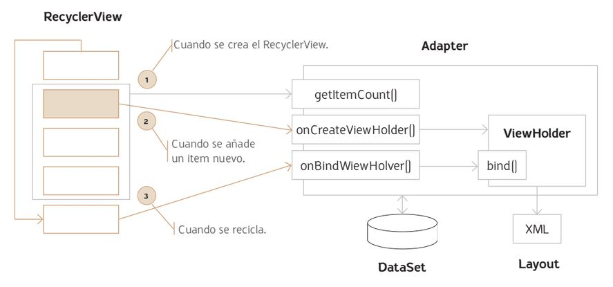

# 5.3 Creación del adaptador

> **Unidad 2 · Aplicaciones Android. Interfaz de usuario**
> Módulo: Programación multimedia y dispositivos móviles (2º DAM)

## Objetivos

Al terminar este apartado deberías ser capaz de:

- Crear la clase **ViewHolder** de una lista usando View Binding.
- Crear la clase **Adapter** e implementar sus tres métodos obligatorios.
- Explicar **cuándo** llama el `RecyclerView` a cada método del adaptador.
- Conectar el `RecyclerView`, el `LayoutManager` y el `Adapter` en una actividad.
- Añadir y eliminar elementos de la lista notificando los cambios al adaptador.

---

## 1. La clase ViewHolder

### 1.1 Qué es

Un **ViewHolder** ("contenedor de vistas") representa **una fila** de la lista. Guarda las referencias a las vistas de esa fila (los `TextView`, el `ImageView`…) para que, cada vez que la fila se recicle, se puedan rellenar **sin volver a buscarlas**.

> 📌 **Relación con el punto 2:** buscar vistas era justo el problema de `findViewById()`. Con View Binding, la clase `ItemPizzaBinding` **ya contiene** todas las vistas de `item_pizza.xml`, así que el ViewHolder solo tiene que guardar el binding.

### 1.2 Crear el ViewHolder

```kotlin
// PizzaViewHolder.kt
package com.dam.pizzeria

import androidx.core.view.isVisible
import androidx.recyclerview.widget.RecyclerView
import com.dam.pizzeria.databinding.ItemPizzaBinding

class PizzaViewHolder(
    private val binding: ItemPizzaBinding        // las vistas de UNA fila
) : RecyclerView.ViewHolder(binding.root) {      // el padre recibe la vista raíz

    /** Rellena esta fila con los datos de una pizza. */
    fun bind(pizza: Pizza) {
        val contexto = binding.root.context

        binding.tvNombre.text = pizza.nombre
        binding.tvIngredientes.text = pizza.ingredientes
        binding.tvPrecio.text = contexto.getString(R.string.precio_euros, pizza.precio)
        binding.ivPizza.setImageResource(pizza.imagen)

        // Se asigna SIEMPRE, también cuando es false (ver sección 1.3)
        binding.tvVegetariana.isVisible = pizza.vegetariana
    }
}
```

```xml
<!-- strings.xml -->
<string name="precio_euros">%1$.2f €</string>
<string name="vegetariana">Vegetariana</string>
```

| Elemento | Qué es |
|---|---|
| `class PizzaViewHolder(private val binding: ItemPizzaBinding)` | El constructor recibe el binding de una fila y lo guarda como propiedad. |
| `: RecyclerView.ViewHolder(binding.root)` | Hereda de `RecyclerView.ViewHolder`, que exige la **vista raíz** de la fila. |
| `fun bind(pizza: Pizza)` | Método **nuestro** (no es obligatorio, pero es la convención) que vuelca los datos en las vistas. |
| `binding.root.context` | Un ViewHolder no es un `Context`: se toma el de su vista para acceder a los recursos. |

### 1.3 La trampa del reciclado

Recuerda el punto 5.1: una fila reciclada **conserva lo que tenía**. Fíjate en esta versión de `bind()`, que parece correcta:

```kotlin
// ❌ Con error
if (pizza.vegetariana) {
    binding.tvVegetariana.isVisible = true
}
```

Si la fila se usó antes para la *Margarita* (vegetariana) y ahora se recicla para la *Barbacoa* (no vegetariana), el texto "Vegetariana" **sigue visible**, porque nadie lo ha ocultado. Hay que cubrir **los dos casos**:

```kotlin
// ✅ Correcto: la propiedad se asigna siempre
binding.tvVegetariana.isVisible = pizza.vegetariana
```

> ✅ **Regla:** en `bind()`, cada vista que cambia según el elemento debe recibir **siempre** un valor, sin `if` que la dejen como estaba.

---

## 2. La clase Adapter

### 2.1 Qué hace

El **Adapter** es el intermediario entre los **datos** y el `RecyclerView`. El `RecyclerView` no sabe nada de pizzas: solo le **pregunta** al adaptador tres cosas, y el adaptador responde con tres métodos obligatorios.



> 📝 En la imagen aparece `onBindWiewHolver()`: es una errata. El método se llama **`onBindViewHolder()`**.

| Método | Pregunta del `RecyclerView` | Cuándo se llama |
|---|---|---|
| `getItemCount()` | ¿Cuántos elementos hay? | ① Al crear el `RecyclerView` y siempre que necesite saber el total. |
| `onCreateViewHolder()` | Necesito una fila **nueva**: créala. | ② Solo cuando no hay ninguna fila para reciclar: al principio, unas pocas. |
| `onBindViewHolder()` | Rellena **esta** fila con los datos de **esta** posición. | ③ Cada vez que una fila va a mostrarse, sea nueva o reciclada. Es el que más se llama. |

### 2.2 Crear el Adapter

```kotlin
// PizzaAdapter.kt
package com.dam.pizzeria

import android.view.LayoutInflater
import android.view.ViewGroup
import androidx.recyclerview.widget.RecyclerView
import com.dam.pizzeria.databinding.ItemPizzaBinding

class PizzaAdapter(
    private val pizzas: List<Pizza>                       // la fuente de datos
) : RecyclerView.Adapter<PizzaViewHolder>() {             // trabaja con PizzaViewHolder

    // ① ¿Cuántos elementos hay?
    override fun getItemCount(): Int = pizzas.size

    // ② Crea una fila nueva: infla item_pizza.xml y la envuelve en un ViewHolder
    override fun onCreateViewHolder(parent: ViewGroup, viewType: Int): PizzaViewHolder {
        val inflater = LayoutInflater.from(parent.context)
        val binding = ItemPizzaBinding.inflate(inflater, parent, false)
        return PizzaViewHolder(binding)
    }

    // ③ Rellena la fila "holder" con la pizza de la posición "position"
    override fun onBindViewHolder(holder: PizzaViewHolder, position: Int) {
        holder.bind(pizzas[position])
    }
}
```

Detalles importantes:

- **`RecyclerView.Adapter<PizzaViewHolder>`**: es una clase **genérica**. Entre `< >` se indica qué ViewHolder usa. Así, `onCreateViewHolder()` devuelve y `onBindViewHolder()` recibe un `PizzaViewHolder`, sin *casts*.
- **`ItemPizzaBinding.inflate(inflater, parent, false)`**: es la forma de `inflate()` con tres parámetros que vimos en el punto 2.3.
  - `parent` es el propio `RecyclerView`: hace falta para calcular bien el tamaño de la fila.
  - `false` indica que **no** se añada todavía al padre: lo hará el `RecyclerView` cuando corresponda. Con `true`, la app falla.
- **`onBindViewHolder()` no rellena las vistas él mismo**: delega en `holder.bind()`. Así, el adaptador sabe **qué** dato va en cada posición y el ViewHolder sabe **cómo** se muestra.

> 📌 **Relación con POO:** `onCreateViewHolder()` es un **método de fábrica** (patrón *Factory Method*): el `RecyclerView` pide un objeto y el adaptador decide cómo crearlo.

### 2.3 Ver el reciclado en acción

Añade un `Log.d()` en los dos métodos para ver cuántas veces se llama cada uno:

```kotlin
override fun onCreateViewHolder(parent: ViewGroup, viewType: Int): PizzaViewHolder {
    Log.d("Adaptador", "onCreateViewHolder")
    // ...
}

override fun onBindViewHolder(holder: PizzaViewHolder, position: Int) {
    Log.d("Adaptador", "onBindViewHolder posición $position")
    holder.bind(pizzas[position])
}
```

Al abrir la pantalla verás unos cuantos `onCreateViewHolder` (las filas visibles). Al desplazarte, aparecerán **muchos `onBindViewHolder` y casi ningún `onCreateViewHolder`**: son las filas recicladas.

---

## 3. Creación del RecyclerView

Ya tenemos todas las piezas. Falta **conectarlas** en la actividad:

```kotlin
class CartaActivity : BaseActivity() {

    private lateinit var binding: ActivityCartaBinding

    override fun onCreate(savedInstanceState: Bundle?) {
        super.onCreate(savedInstanceState)
        enableEdgeToEdge()
        binding = ActivityCartaBinding.inflate(layoutInflater)
        setContentView(binding.root)
        // ... insets ...
        configurarToolbar(binding.toolbar.root)

        configurarRecyclerView()
    }

    private fun configurarRecyclerView() {
        binding.rvPizzas.layoutManager = LinearLayoutManager(this)    // 1. cómo se colocan
        binding.rvPizzas.adapter = PizzaAdapter(FuenteDatos.pizzas)   // 2. de dónde salen
    }
}
```

¡Y ya está! Ejecuta la app: la carta aparece y se desplaza con fluidez, aunque tenga cientos de pizzas.

| Paso | Código |
|---|---|
| 1. Asignar el `LayoutManager` | `rvPizzas.layoutManager = LinearLayoutManager(this)` |
| 2. Asignar el `Adapter` con los datos | `rvPizzas.adapter = PizzaAdapter(lista)` |

> 💡 Con `with(binding.rvPizzas) { ... }` (punto 2.3) se evita repetir `binding.rvPizzas`:
>
> ```kotlin
> with(binding.rvPizzas) {
>     layoutManager = LinearLayoutManager(this@CartaActivity)
>     adapter = PizzaAdapter(FuenteDatos.pizzas)
>     setHasFixedSize(true)   // el tamaño del RecyclerView no depende de su contenido: optimiza
> }
> ```
>
> Dentro del `with`, `this` es el `RecyclerView`, por eso el contexto se escribe `this@CartaActivity`.

### 3.1 Separadores entre elementos

Si los elementos no son tarjetas, una línea entre ellos ayuda a distinguirlos. Se añade con una **decoración**:

```kotlin
binding.rvPizzas.addItemDecoration(
    DividerItemDecoration(this, DividerItemDecoration.VERTICAL)
)
```

> 📝 Con `MaterialCardView` no suele hacer falta: el margen y la sombra de cada tarjeta ya separan los elementos.

### 3.2 Cambiar a cuadrícula

Como vimos en el punto 5.2, basta con cambiar el `LayoutManager`. Por ejemplo, 2 columnas en vertical y 3 en horizontal:

```kotlin
val columnas = if (resources.configuration.orientation == Configuration.ORIENTATION_LANDSCAPE) 3 else 2
binding.rvPizzas.layoutManager = GridLayoutManager(this, columnas)
```

> 💡 Para una cuadrícula, el layout del elemento queda mejor en vertical: la imagen arriba, a todo el ancho, y el texto debajo. Puedes tener un `item_pizza_grid.xml` aparte.

---

## 4. Modificar los datos de la lista

Hasta ahora la lista era fija (`List<Pizza>`). En una app real, los elementos se **añaden y eliminan**. Para eso, el adaptador necesita una lista **mutable** y debe **avisar** al `RecyclerView` de cada cambio, porque este no lo detecta solo.

```kotlin
class PizzaAdapter(
    private val pizzas: MutableList<Pizza>
) : RecyclerView.Adapter<PizzaViewHolder>() {

    // ... getItemCount, onCreateViewHolder, onBindViewHolder igual ...

    fun anadir(pizza: Pizza) {
        pizzas.add(pizza)
        notifyItemInserted(pizzas.lastIndex)           // animación de entrada
    }

    fun eliminar(posicion: Int): Pizza {
        val borrada = pizzas.removeAt(posicion)
        notifyItemRemoved(posicion)                    // animación de salida
        return borrada
    }

    fun insertar(posicion: Int, pizza: Pizza) {
        pizzas.add(posicion, pizza)
        notifyItemInserted(posicion)
    }
}
```

```kotlin
// En la actividad
private val adaptador = PizzaAdapter(FuenteDatos.pizzas.toMutableList())   // copia mutable
```

| Método de aviso | Cuándo usarlo |
|---|---|
| `notifyItemInserted(pos)` | Se ha añadido un elemento en `pos`. |
| `notifyItemRemoved(pos)` | Se ha eliminado el elemento de `pos`. |
| `notifyItemChanged(pos)` | Han cambiado los datos del elemento de `pos`. |
| `notifyItemMoved(desde, hasta)` | Un elemento ha cambiado de posición. |
| `notifyDataSetChanged()` | Ha cambiado "todo". Redibuja la lista entera, **sin animaciones**: úsalo solo como último recurso. |

> ⚠️ **Si cambias la lista y no avisas**, el `RecyclerView` sigue mostrando los datos antiguos o la app falla con *Inconsistency detected*. Cada cambio en los datos va acompañado de su `notify…()`.

> 📝 **Para ir más allá:** `ListAdapter` con `DiffUtil` calcula automáticamente qué ha cambiado entre dos listas y lanza los `notify…()` por nosotros. Es la opción habitual en apps profesionales, junto a arquitecturas como MVVM.

---

## 5. Practica

1. En el proyecto del punto 5.2, crea `PizzaViewHolder` con su método `bind()`.
2. Crea `PizzaAdapter` con sus tres métodos y conecta todo en la actividad. Ejecuta la app y desplázate por la carta.
3. Añade los `Log.d()` de la sección 2.3. ¿Cuántas veces se llama a `onCreateViewHolder()` al abrir la pantalla? ¿Y después de recorrer toda la lista?
4. Provoca el error de la sección 1.3: escribe `bind()` con un `if` que solo **muestra** "Vegetariana". Desplázate varias veces arriba y abajo. ¿Qué observas? Corrígelo.
5. Cambia `false` por `true` en `ItemPizzaBinding.inflate(inflater, parent, false)` y ejecuta. ¿Qué excepción aparece en el Logcat? Vuelve a dejarlo en `false`.
6. Cambia el `LayoutManager` a un `GridLayoutManager` de 2 columnas y después a un `LinearLayoutManager` horizontal. ¿Qué has tenido que tocar del adaptador?
7. Haz que la lista sea mutable y añade un botón *Añadir pizza* que inserte una pizza nueva al final con `notifyItemInserted()`. Haz que la lista se desplace hasta ella con `binding.rvPizzas.scrollToPosition(…)`.
8. **Reto:** añade un `MaterialSwitch` *Solo vegetarianas* encima de la lista. Al activarlo, el adaptador debe mostrar solo las pizzas vegetarianas, y al desactivarlo, todas.

---

## 6. Autoevaluación

1. ¿Qué es un ViewHolder y qué problema resuelve?
2. ¿Por qué el constructor de `RecyclerView.ViewHolder` recibe `binding.root`?
3. ¿Por qué en `bind()` hay que asignar siempre un valor a cada vista, sin `if` que la dejen como estaba?
4. ¿Qué tres métodos debe implementar un adaptador? ¿Qué pregunta responde cada uno?
5. ¿Cuál de los tres se llama más veces? ¿Por qué?
6. ¿Qué significan los parámetros `parent` y `false` en `ItemPizzaBinding.inflate(inflater, parent, false)`?
7. ¿Por qué `RecyclerView.Adapter` lleva un tipo entre `< >`?
8. ¿Qué dos líneas conectan un `RecyclerView` con su `LayoutManager` y su adaptador?
9. Si añades un elemento a la lista de datos, ¿qué debe hacer el adaptador? ¿Por qué?
10. ¿Por qué se desaconseja `notifyDataSetChanged()`?

---

## 📚 Para saber más (documentación oficial)

- [Cómo crear listas dinámicas con RecyclerView · Implementa tu adaptador](https://developer.android.com/develop/ui/views/layout/recyclerview?hl=es-419) · Adaptador y ViewHolder paso a paso.
- [Referencia de RecyclerView.Adapter](https://developer.android.com/reference/androidx/recyclerview/widget/RecyclerView.Adapter) (en inglés) · Todos los métodos `notify…()`.
- [ListAdapter](https://developer.android.com/reference/androidx/recyclerview/widget/ListAdapter) (en inglés) · Adaptador con `DiffUtil`, para ir más allá.

---

⬅️ [5.2 Elementos para crear un RecyclerView](05-2-elementos-recyclerview.md) · 🏠 [Índice](../README.md) · ➡️ [5.4 Gestión de eventos en el RecyclerView](05-4-eventos-recyclerview.md)
